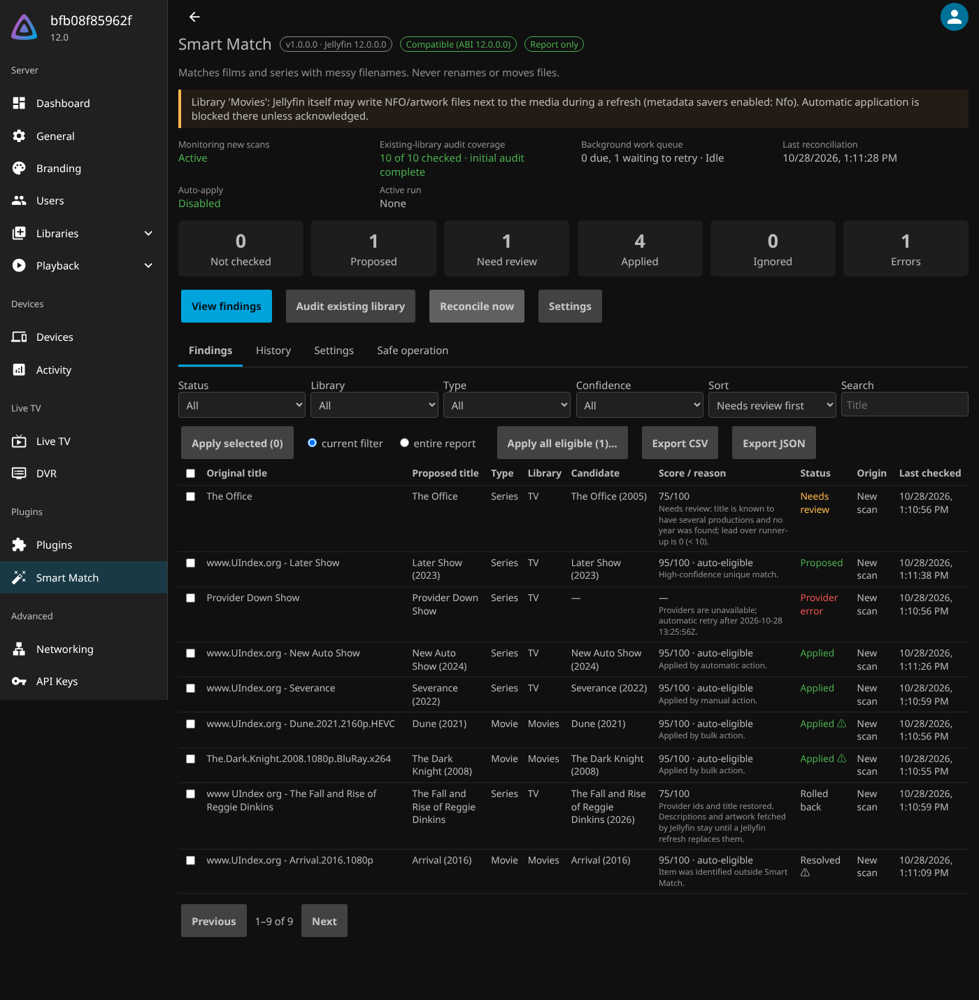

# Jellyfin Smart Match

**Better metadata matching for media with messy filenames, without renaming your files.**

Smart Match is a native Jellyfin 12 plugin. It finds films and series that Jellyfin could not identify because their folder or file names carry release-site watermarks or release tags, works out a clean search title, asks the metadata providers your libraries already use for candidates, and lists the results in a report you control. It never renames, moves or edits media files, so libraries shared with Plex or referenced by qBittorrent stay untouched.

```text
On disk (unchanged):        www.UIndex.org - The Fall and Rise of Reggie Dinkins/
Search title:               The Fall and Rise of Reggie Dinkins
Trace:                      removed site-prefix (site.uindex): www.UIndex.org · trimmed separator: -
Applied (after your click): Tmdb id + title, then a normal Jellyfin metadata refresh
```



## Features

- **Scan monitoring**: new or changed films and series are picked up from Jellyfin's own scan events, after the scan, without slowing it down. A post-scan reconciliation and a daily scheduled task catch anything missed.
- **Existing-library audit**: on first start, a report-only background audit checks everything Jellyfin indexed before the plugin was installed. Run it again any time; unchanged items are not searched twice.
- **Careful name cleaning**: removes known release-site watermarks and release tags only from recognisable prefixes and suffixes; keeps titles such as *Web*, *Complete Unknown*, *Up*, *1917*, *Spider-Man*, *Mr. Robot* and *S.H.I.E.L.D.* intact; keeps years and episode markers as evidence. Every step is shown.
- **Uses your providers**: searches through each library's enabled Jellyfin metadata providers and language settings. No extra API keys.
- **Findings report**: original and cleaned title, candidates with scores and reasons, status, origin (new scan or existing audit), filters, search, sorting, details, CSV/JSON export.
- **Apply one, Apply selected, Apply all eligible**: every bulk action shows a preview of exactly what will change and what is excluded, needs confirmation, re-checks each item right before writing, and reports per-item outcomes.
- **Optional auto-apply**, off by default, per library: only unique, exact-title, exact-year matches with a clear lead are applied unattended.
- **Safety**: report-only default, locked items and existing identities respected, stale previews rejected, conditional rollback, full change history, crash-safe state, admin-only API.

## Install

Add this repository in **Dashboard → Plugins → Repositories**, install **Smart Match** from the catalogue, restart Jellyfin:

```text
https://raw.githubusercontent.com/clemarc/jellyfin-smartmatch/catalog/manifest.json
```

The catalogue is published by the release workflow when the owner creates the first `v1.0.0.0` tag (pushed from git or via a release published in the GitHub web UI); until then use the ZIP from a CI run. Full instructions, manual install, updates and Docker advice: [docs/install.md](docs/install.md). Daily use: [docs/operations.md](docs/operations.md).

## Compatibility

| Component | Supported |
|---|---|
| Jellyfin | 12.x (built for ABI 12.0.0.0; tested on 12.0 and 12.4) |
| Runtime | .NET 10, AnyCPU managed plugin |
| Hosts | Linux x64 and ARM64 (Raspberry Pi 400 with 64-bit OS), Docker |
| Media | Films and TV series |

See [docs/compatibility.md](docs/compatibility.md) for exactly what was tested.

## How applying works

Smart Match writes only the chosen provider ids, and the title when it is still the unedited filename-derived one. It then asks Jellyfin for a normal refresh that fills missing metadata and artwork; existing images are never replaced and locked fields stay locked. If a library has NFO savers or *Save artwork into media folders* enabled, **Jellyfin itself** writes those files during any refresh. Smart Match warns about such libraries and blocks unattended auto-apply there until you accept it. Mounting media read-only is recommended.

## Known limitations

- With the default refresh profile, **episode titles** that Jellyfin derived from filenames are not replaced (overviews, dates and missing artwork are filled). Choose *Replace unlocked text metadata* in Settings to replace them too.
- Items that already have a provider id are never re-examined, even if that id is wrong; use Jellyfin's Identify for those.
- Anime absolute numbering, multi-edition films and multi-language aliases are not specially handled (PRD P1).
- Integration tests use an offline stub provider; behaviour against live TMDb/TVDb depends on those services.
- Downgrading the plugin is not supported (see install guide).

## Development

Build, test, package and run the disposable Jellyfin acceptance tests: [AGENTS.md](AGENTS.md). Design: [PRD.md](PRD.md), [TECHNICAL_DESIGN.md](TECHNICAL_DESIGN.md), decisions: [docs/adr](docs/adr/README.md).

## Licence

MIT. No code from other Jellyfin plugins is included; [Filename Title](https://github.com/adielsa/jellyfin-filename-title) was prior art only.
