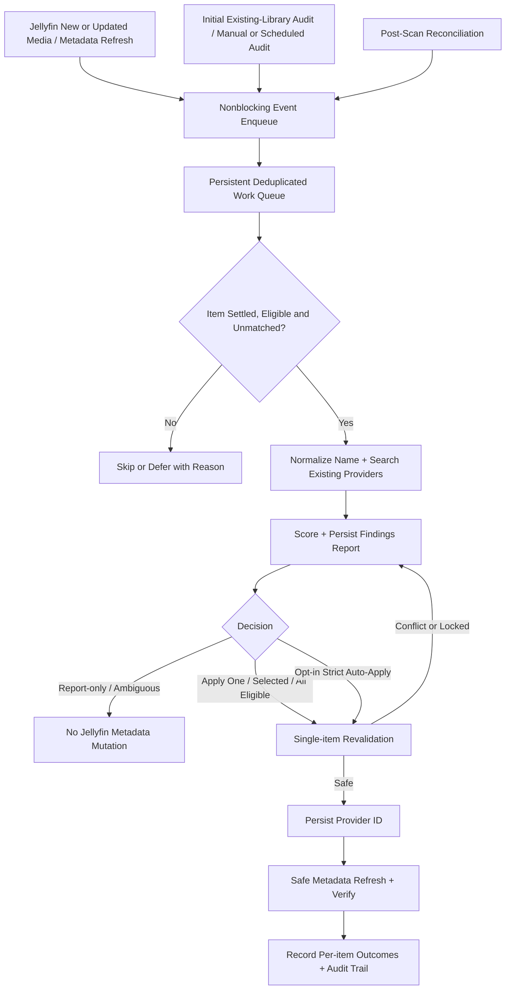
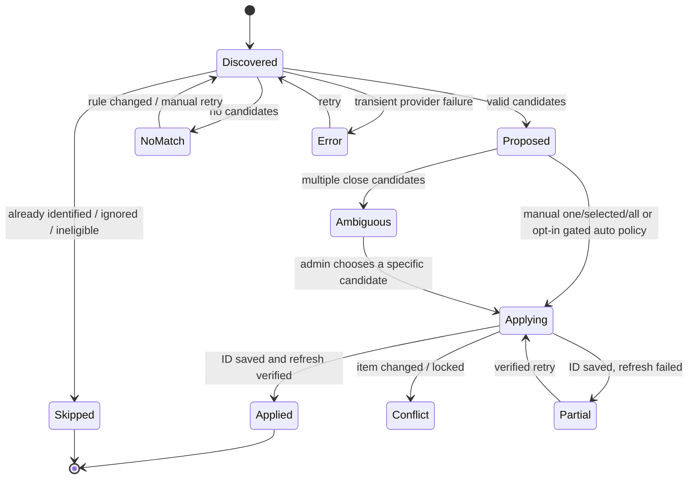

# Smart Match for Jellyfin — Technical Design Document

**Status:** Proposed architecture, subject to an API compatibility spike  
**Version:** 0.1  
**Date:** 28 October 2026  
**Companion:** [PRD.md](./PRD.md)  
**Target release baseline:** Jellyfin **12.0**, .NET **10**; upgrade/verify a later 12.x release explicitly  
**Target environments:** Linux ARM64 (Raspberry Pi 400, Docker) and Linux x64 (CI/dev)  
**Design style:** Single native, in-process C# plugin; no external worker/container

> **Important:** References to interfaces below were inspected in the Jellyfin `v12.0` source or current Jellyfin sources on 28 October 2026. This document specifies intended usage, not proof that all composition/lifecycle details are compatible. Codex MUST complete the M0 API spike, compile against the pinned release, and execute an integration test before implementing writes. Do not replace these with undocumented endpoints or assume that a later `main` branch is binary-compatible.

## 1. Architecture decision record

| Decision | Choice | Reason |
|---|---|---|
| Plugin type | In-process Jellyfin plugin in C# | Native settings/tasks/library APIs; user explicitly prefers plugin over external service |
| Jellyfin baseline | 12.0 / .NET 10, package against released NuGet versions | Jellyfin 12 changed plugin ABI and requires .NET 10; constrain support promises |
| First integration point | Nonblocking item/refresh observation + bounded background queue + `ILibraryPostScanTask` reconciliation, all in v1.0 | Runs alongside normal library scans without blocking or racing them; missed events reconciled |
| Candidate search | `IProviderManager.GetRemoteSearchResults<Series, SeriesInfo>` / `<Movie, MovieInfo>` | Reuses providers and library settings already in Jellyfin |
| Metadata application | Revalidate item, set selected provider ID, persist using library APIs, request safe provider refresh | Avoid direct DB manipulation; does not rename media |
| Automatic decisions | Report-only default; one/selected/all eligible manual apply plus opt-in per-library strict auto all in v1.0 | User chooses whether/when to mutate metadata; ambiguity stays in report |
| Review UI | Embedded Jellyfin plugin settings page + authenticated admin-only API endpoints | No second application and works via mobile/desktop Jellyfin admin |
| Persistence | Plugin-local bounded JSON decision journal + settings XML or plugin-standard config; atomic update | Simpler than new DB on a Raspberry Pi; portable and restart-safe |
| Distribution | GitHub Releases ZIP + GitHub-hosted `manifest.json` on a CI-managed `catalog` branch | No hosting or Pages dependency; standard Jellyfin plugin repository |
| Deployment | Add repository URL in Jellyfin, install ZIP through catalogue, restart | Familiar Jellyfin UX; plugin not tied to a public web server |
| Licensing | Select open-source license before repository publication | Allows community review and contribution; no upstream code copied without review |

### Alternative approaches rejected for initial release

- **Fork of Filename Title:** No provider search/identity persistence, problematic folder handling, outdated ABI and unsafe PR logic.
- **Separate TypeScript/Python Docker service:** User explicitly prefers a native Jellyfin plugin; an external service cannot reliably participate in Jellyfin internal lifecycle.
- **Direct TMDb REST integration:** Would duplicate configuration, credentials, rate limiting and localization, and bypass enabled Jellyfin providers.
- **`IPreRefreshProvider` as initial hook:** More elegant in theory, but ordering, refresh recursion and mutation semantics require careful integration verification. v1.0 observes scans without blocking the metadata provider pipeline; evaluate pre-refresh later.
- **GitHub Pages as primary hosting:** Not required: Jellyfin accepts any HTTPS manifest URL and ZIP release URLs. Pages remains an optional docs site.

## 2. Operating environment and assumptions

- Server: Raspberry Pi 400, ideally 64-bit ARM (`dpkg --print-architecture` should return `arm64`); Jellyfin in a Docker container with a persistent `/config` volume.
- Jellyfin and Plex can read the same media directories. Some paths may still be torrent payload targets.
- Library already has TV and movie collections. Clients are Android TV, Apple tablets/phones and laptops, often via Tailscale. Plugin functionality is independent of codecs, hardware transcoding and remote client app choice.
- Docker container needs outbound HTTPS to whichever metadata providers the library enables **and** to GitHub to install/update catalogue plugins. No inbound/public HTTP endpoints other than existing Jellyfin access are introduced.
- Library media mounts should be **read-only** wherever possible. Some Jellyfin metadata refresh options can cause sidecar/NFO writes if the server is configured that way; test this and expose a warning (see §12).
- This plugin must not assume the user has already upgraded Debian Bullseye to Bookworm, or that TLS/CA issues are fixed. CA/certificate/network problems are environmental and must surface as actionable provider errors; do not bypass TLS validation.
- The eventual repo name, owner, plugin GUID and first release tag are placeholders until implementation. Generate a new GUID; do not reuse the upstream Filename Title GUID or the Jellyfin plugin-template GUID.

## 3. Components and data flow



**All work on scanner events is asynchronous and nonblocking.** Event handlers enqueue IDs and return immediately; no network calls, metadata mutations, or unbounded waits in Jellyfin scan/refresh callbacks. Work starts only when the item is no longer under active Jellyfin metadata processing. A reconciliation pass captures missed changes. All paths (new scan, existing audit, manual, bulk, auto) share the same normalizer, matcher, eligibility rules and `MatchApplicationService` single writer. Report-only never mutates Jellyfin item metadata.

### Proposed projects

```text
jellyfin-plugin-smartmatch/
├── README.md
├── LICENSE
├── PRD.md
├── TECHNICAL_DESIGN.md
├── AGENTS.md                         # Codex workflow instructions, created by Codex
├── global.json                        # Pin dotnet SDK 10.x
├── Directory.Build.props              # Version and analyzers
├── build.yaml                         # Plugin metadata and targetAbi
├── src/Jellyfin.Plugin.SmartMatch/
│   ├── Jellyfin.Plugin.SmartMatch.csproj
│   ├── Plugin.cs                       # Unique GUID; BasePlugin config; embedded page
│   ├── PluginServiceRegistrator.cs     # DI registration
│   ├── Configuration/
│   │   ├── PluginConfiguration.cs
│   │   └── configPage.html
│   ├── Discovery/
│   │   ├── LibraryCandidateFinder.cs
│   │   └── ItemEligibilityEvaluator.cs
│   ├── Normalization/
│   │   ├── MediaNameNormalizer.cs
│   │   ├── PrefixRuleEngine.cs
│   │   └── NameEvidence.cs
│   ├── Matching/
│   │   ├── JellyfinProviderSearchAdapter.cs
│   │   ├── MatchCandidateRanker.cs
│   │   ├── MatchPolicy.cs
│   │   └── ProviderIdValidator.cs
│   ├── Application/
│   │   ├── MatchApplicationService.cs
│   │   ├── BulkApplyCoordinator.cs
│   │   ├── MetadataRefreshService.cs
│   │   └── ConditionalRollbackService.cs
│   ├── Jobs/
│   │   ├── AuditScheduledTask.cs
│   │   ├── ScanEventObserver.cs        # Lightweight event capture only
│   │   ├── WorkQueueService.cs         # Bounded persistent jobs, dedupe
│   │   ├── InitialLibraryAudit.cs      # Already-scanned media, checkpointed
│   │   └── PostScanTask.cs             # v1.0 reconciliation
│   ├── Storage/
│   │   ├── ReviewJournal.cs
│   │   ├── ReviewRepository.cs
│   │   └── RunRepository.cs
│   ├── Api/
│   │   ├── SmartMatchController.cs
│   │   └── Contracts/
│   └── Diagnostics/
│       └── SmartMatchHealthReport.cs
├── tests/
│   ├── SmartMatch.UnitTests/
│   ├── SmartMatch.IntegrationTests/
│   └── Fixtures/
├── scripts/
│   ├── package.sh
│   ├── update-manifest.py
│   └── verify-release.py
├── .github/workflows/
│   ├── ci.yml
│   ├── release.yml
│   └── codeql.yml                    # optional, after functionality stabilized
└── docs/
    └── install.md
```

The namespace and project layout are illustrative. Codex may simplify modules if tests and boundaries stay intact.

## 4. Plugin lifecycle and Jellyfin APIs

### 4.1 Bootstrap

- `Plugin : BasePlugin<PluginConfiguration>, IHasWebPages` with persistent unique GUID, `Name`, optional description, embedded config page.
- `PluginServiceRegistrator : IPluginServiceRegistrator` registers stateless services, a synchronized journal, task(s), and controller dependencies in Jellyfin DI.
- Use `ILogger<T>` for structured logging, `CancellationToken` for all async work.
- **Do not** perform network searches, library walks, fire-and-forget tasks or metadata modifications in `Plugin` constructor.
- Plugin settings are Jellyfin-local. Keep secrets out of config; there are no custom provider credentials in v1.

### 4.2 Confirmed interfaces from Jellyfin 12.0 source

| API / class | Confirmed intent | Notes |
|---|---|---|
| `ILibraryManager` | Access/query Jellyfin items; get item by GUID; update via `UpdateItemAsync` | Test parent and lock semantics; do not use direct database writes |
| `IProviderManager.GetRemoteSearchResults<TItem,TLookup>` | Ask existing metadata search providers for remote candidates | `RemoteSearchQuery<T>` carries `SearchInfo`, `ItemId`, `IncludeDisabledProviders`, optional `SearchProviderName` |
| `Series`, `SeriesInfo` | Series record and lookup info | Normalize **folder** title; do not target `Episode` as root match |
| `Movie`, `MovieInfo` | Movie record and lookup info | Prefer film folder; handle mixed-folder naming carefully |
| `RemoteSearchResult` | Result name, year, provider IDs, provider name, etc. | Must have usable ID before applying |
| `IScheduledTask` | Admin-run / scheduled audit | Check task registration/discovery on pinned 12.x |
| `ILibraryPostScanTask.Run` | Execute after library scan | v1.0 reconciliation; callback must avoid an unbounded synchronous audit |
| `ILibraryManager.ItemAdded` / `ItemUpdated`; `IProviderManager.RefreshCompleted` | Capture new/changed items and completed metadata refresh | v1.0 candidate signals; exact timing and event registration must be verified in M0 |
| `IProviderManager.RefreshSingleItem` / `RefreshFullItem` | Request Jellyfin metadata refresh | Use the least invasive suitable mode; validate in integration tests |
| `IPreRefreshProvider : ICustomMetadataProvider` | Potential pre-refresh extension | P2 experiment; do not wire into v1.0 |
| `IHasWebPages` | Embedded settings page | Test layout on Jellyfin 12 Modern web layout |

Source references (pin to `v12.0` when browsing in implementation):

- [`IProviderManager.cs`](https://github.com/jellyfin/jellyfin/blob/v12.0/MediaBrowser.Controller/Providers/IProviderManager.cs)
- [`ILibraryManager.cs`](https://github.com/jellyfin/jellyfin/blob/v12.0/MediaBrowser.Controller/Library/ILibraryManager.cs)
- [`ILibraryPostScanTask.cs`](https://github.com/jellyfin/jellyfin/blob/v12.0/MediaBrowser.Controller/Library/ILibraryPostScanTask.cs)
- [`IPreRefreshProvider.cs`](https://github.com/jellyfin/jellyfin/blob/v12.0/MediaBrowser.Controller/Providers/IPreRefreshProvider.cs)
- [`RemoteSearchQuery.cs`](https://github.com/jellyfin/jellyfin/blob/v12.0/MediaBrowser.Controller/Providers/RemoteSearchQuery.cs)
- [`RemoteSearchResult.cs`](https://github.com/jellyfin/jellyfin/blob/v12.0/MediaBrowser.Model/Providers/RemoteSearchResult.cs)
- [`MetadataRefreshOptions.cs`](https://github.com/jellyfin/jellyfin/blob/v12.0/MediaBrowser.Controller/Providers/MetadataRefreshOptions.cs)

### 4.3 API spike / proof required before writes (M0)

1. Start a disposable Jellyfin 12.0 Docker server with synthetic library and known TMDb metadata configuration. Pin image by version/digest in CI.
2. Build plugin with .NET 10, `Jellyfin.Controller` and `Jellyfin.Model` packages pinned to a released compatible 12.x version, with runtime assets excluded. **Do not simply reuse the existing jellyfin-plugin-template's older `net9.0`/10.11 dependencies.**
3. Verify `IScheduledTask` discovery and `IHasWebPages` settings page visible.
4. Query an unmatched `Series` record with:

```csharp
// Illustrative only: verify APIs and field defaults against pinned v12.x.
var query = new RemoteSearchQuery<SeriesInfo>
{
    ItemId = series.Id,
    IncludeDisabledProviders = false,
    SearchInfo = new SeriesInfo
    {
        Name = normalizedTitle,
        Year = trustedYear,
        MetadataLanguage = libraryLanguage,
        MetadataCountryCode = libraryCountry,
        IsAutomated = true
    }
};
var results = await providerManager
    .GetRemoteSearchResults<Series, SeriesInfo>(query, cancellationToken);
```

5. Prove that searching uses only enabled providers and respects source library options. Test `Movie/MovieInfo` equivalent. If the generic search pathway does **not** honor library settings as expected, adapt the adapter with verified API behavior and document it. Never silently query disabled providers.
6. Verify post-refresh behavior for an explicit provider ID: set ID via a validated, public-ish Jellyfin internal API, persist changes, call minimal metadata refresh, observe the canonical title/poster and verify preserved file path and locks. Use a disposable record; snapshot state before/after.
7. Determine whether the refresh can invoke sidecar savers and under which `MetadataRefreshOptions` and library settings. Record a functional test.
8. Verify event lifecycle: `ItemAdded`, `ItemUpdated`, `RefreshCompleted`, `ILibraryPostScanTask`, event ordering, item identity and plugin registration. Confirm that event capture does not delay scanner operations, and implement fallback reconciliation if a callback does not fire.
9. Verify transaction/concurrency behavior when Jellyfin is scanning and when a library item is deleted/renamed during audit.
10. Verify all of `Apply one`, `Apply selected`, `Apply all eligible`, and opt-in auto-apply against a disposable library before shipping.
9. Verify admin authorization and embedded page API calls under Jellyfin 12 Modern layout. Use its supported `Authorization` convention; avoid legacy unauthenticated URLs.

**Exit gate:** A reproducible, passing integration smoke test. If the public internal API cannot safely assign IDs, stop and revise design rather than using Jellyfin SQL or undocumented `/Items/*` requests.

## 5. Discovery and eligibility

### Discovery query

Walk item records using Jellyfin library APIs, not the raw media filesystem. Filter to record types `Series` and `Movie`, configured libraries only, excluding virtual items, missing items, and items inaccessible under expected library configuration. Prefer page/batch queries with no artwork/detail loading when possible.

Use Jellyfin's record identifiers as stable run keys. Item IDs can change following library rebuilds, so the journal also retains **a salted hash of path and media type**, not a path as a sole identity. Display real paths only in the authenticated admin detail view.

### Eligibility algorithm

```
for each Series/Movie record in allowed libraries:
  if item is missing/virtual: skip(MISSING)
  if item is manually locked: skip(LOCKED)
  if admin excluded the item: skip(IGNORED)
  if active refresh or scan conflict: defer(BUSY)
  if reliable external provider ID exists: skip(ALREADY_IDENTIFIED)
  derive name evidence from Jellyfin metadata, path basename, containing folder
  if candidate names are blank/unsafe: skip(UNPARSABLE)
  compute normalized title and signature
  if same signature has a recent complete result: reuse cached result
  enqueue for remote search
```

A provider ID is usually a reliable identification marker, but allow a **manual force-review** action for known wrong existing IDs (future increment); never auto-override them.

**Series:** Base folder is first-class; the old Filename Title plugin's `IsFolder=false` filter is not suitable. Normalizing a `Series` record is distinct from normalizing an episode filename. Episode names can be used only as fallback evidence.

**Movies:** Jellyfin's `Movie.GetLookupInfo()` often favors containing folder when not in a mixed folder. Normalization should align with the same primary name and record its provenance. Handle `Movie (Year)` folders and filenames with scene suffixes.

## 6. Normalization design

### Contract

```csharp
public sealed record NormalizationResult(
    string OriginalName,
    string SearchTitle,
    int? TrustedYear,
    IReadOnlyList<NormalizationStep> Steps,
    string SourceKind,
    bool IsSafe,
    IReadOnlyList<string> Warnings);

public interface IMediaNameNormalizer
{
    NormalizationResult Normalize(MediaNameInput input, RuleSet rules);
}
```

Implement as **pure code** with no Jellyfin database/network dependencies. Avoid indiscriminate `string.Replace` on common release tag words.

### Transform order

1. Extract basename from a verified library path. Do not use `Path.GetFileNameWithoutExtension` on arbitrary series folder names containing periods; only strip extensions from known media files.
2. Parse explicit Jellyfin provider IDs and keep them as evidence; do not strip and forget valid IDs.
3. Parse trailing episode tokens and year in context; store separately.
4. Match known site watermarks with **anchored** expressions (`^\s*(?:www\.)?uindex\.org\s*[-_. ]+`) and user rules. Enforce regex timeouts, length limits and reject invalid patterns.
5. Segment scene tokens (`WEB-DL`, `BluRay`, `2160p`, `x265`, release group) from right/suffix or known release patterns, not ordinary words anywhere in title.
6. Normalize separators, Unicode and whitespace while preserving meaningful punctuation.
7. Strip leading/trailing separator debris (`-`, `_`, `.`, spaces) after prefix removal.
8. Validate title (nonempty, sensible minimum length, not only a year/tag). Generate trace of applied steps.
9. Derive a distinct comparison key (casefold, Unicode normalization, punctuation-insensitive) but retain the human-readable search title.

### Default rules

- Built-in exact site prefix patterns kept in version-controlled tests (`uindex.org` initial fixture; add common domains based on evidence rather than broad `\w+\.\w+` removal).
- User-editable source-prefix patterns anchored to the start, **disabled until tested in preview**.
- Configurable exclusions/allowlist for unusual titles.
- All rules have stable IDs, enabled status, friendly explanation and example transformation.

### Required normalization fixtures

```text
www.UIndex.org - The Fall and Rise of Reggie Dinkins
  => The Fall and Rise of Reggie Dinkins
www.UIndex.org - The.Fall.and.Rise.of.Reggie.Dinkins.S01E01.1080p.WEB-DL.mkv
  => The Fall and Rise of Reggie Dinkins  [series context; S01E01 retained separately]
The.Dark.Knight.2008.1080p.BluRay.x264.mkv
  => The Dark Knight; Year=2008
Dune.1984.1080p.mkv => Dune; Year=1984
Dune.2021.2160p.HEVC.mkv => Dune; Year=2021
The.Office.S03E05.720p.WEB-DL.mkv => The Office [ambiguous; never auto]
Web.2013.mkv => Web; Year=2013
Complete.Unknown.2024.mkv => Complete Unknown; Year=2024
Mr.Robot.S01E01.mkv => Mr Robot [comparison key], Mr. Robot [display/search preferred]
```

These expected results are **unit-test fixtures**, not asserted remote metadata identities. Include fixtures for legitimate `.com` title text, dots, numeric films like `1917`, hyphenated titles, accents, apostrophes, emoji, paths with Unicode, and title-only folders that have no extension.

## 7. Candidate search and ranking

### Search adapter

`JellyfinProviderSearchAdapter` takes `MediaType`, Jellyfin item ID, clean title, trusted year, library locale, and cancellation token. It calls `IProviderManager.GetRemoteSearchResults` using `Series/SeriesInfo` or `Movie/MovieInfo`. Capture returned `RemoteSearchResult.Name`, `ProductionYear`, `ProviderIds`, `SearchProviderName`, `Overview` only if needed. Do not persist full provider payloads unnecessarily.

- `IncludeDisabledProviders = false` is mandatory.
- Respect provider-specific restrictions/terms through Jellyfin provider integrations.
- Use the library's metadata language/country defaults. Explicitly verify that this query path honors enabled providers in M0.
- Never send full media paths as the remote query unless Jellyfin requires a local path for internal dispatch; redact from logs.
- Deduplicate by provider namespace + ID, fold results when the same TMDb ID is reported by multiple configured sources.
- A candidate without a usable external ID is review-only and cannot be applied.

### Scoring algorithm

Separate `rankScore` (for display) from `autoEligible` (hard gate). Avoid treating numerical similarity as calibrated probability.

Suggested deterministic v1 formula, subject to fixture tuning:

| Signal | Max score | Details |
|---|---:|---|
| Normalized name similarity | 70 | 70 exact comparison key; 55–69 high similarity; less for fuzzy token match |
| Year agreement | 20 | 20 exact year, 10 within 1 year where justified; zero if unknown |
| Provider corroboration | 5 | Same ID returned by multiple distinct enabled sources, if present |
| Clean parse confidence | 5 | Input rules anchored, no conflicting extraction warnings |
| **Total** | **100** | UI displays as `match score / 100`, not percent likelihood |

Hard penalties: mismatch of media type or an implausible year -> reject; conflicting provider IDs or competing equally credible title -> manual only; no trusted year -> manual-only default. Consider common-title ambiguity even on exact normalized match.

`autoEligible` v1.0 (explicit opt-in) must require:
- explicit admin opt-in for that library;
- no preexisting reliable ID or metadata lock;
- candidate unique after deduplication;
- comparison title exactly equivalent and trusted year exactly matching (default);
- `score >= 95` and score difference to the runner-up `>= 10` when there is a runner-up;
- valid supported provider ID;
- no risky local NFO/sidecar configuration;
- source item unchanged since audit;
- successful preflight for metadata refresh.

A score of 100 on a title like `The Office` without year **must not** satisfy the auto policy. Keep a small explicit ambiguity test catalogue; do not hard-code the catalogue as the only safety check.

### Remote request budget

- Default global concurrency 1, minimum 500ms pause between remote searches (configurable up to a safe cap), per-run budget, per-library budget.
- `CancellationToken` + timeout per provider call; do not assume the provider client itself honors timeout.
- Retry network/transient 429/5xx with exponential backoff and jitter, bounded to three attempts; do not retry 404 indefinitely.
- Cache `(item ID, source signature, normalized query, provider configuration fingerprint)` and results with bounded TTL; do not reuse stale results if rules or provider configuration changed.
- Defer new searches while the server is under load or an admin cancels.

## 8. Review state and persistence

### Proposed entities (not EF/Jellyfin DB migrations)

```text
AuditRun
  RunId: UUID
  StartedAtUtc, EndedAtUtc, Mode, Status, JellyfinVersion, PluginVersion
  Counts: scanned/skipped/proposed/ambiguous/applied/failed

ReviewItem
  ReviewId: UUID
  JellyfinItemId: UUID, LibraryId: UUID, MediaType: Series|Movie
  OriginalName, OriginalPathHash, SearchTitle, TrustedYear
  NormalizationTrace[]; QueryFingerprint; ItemSnapshotFingerprint
  Status; ErrorCode?; LastCheckedAtUtc; VersionETag
  Candidates[] (bounded, e.g. top 10)

Candidate
  CandidateId: stable provider namespace + ID
  Name, Year?, ProviderName, ProviderIds, RankScore, Reasons[], AutoEligible

DecisionRecord
  DecisionId, ReviewId, AdminActorId, TimeUtc, Action
  BeforeProviderIds, WrittenProviderIds, BeforeTitle?, ObservedAfterTitle?
  Outcome, ErrorCode?, RefreshOutcome, ItemSnapshotFingerprint
```

**Storage:** For initial deployment, persist bounded data under the plugin's Jellyfin-owned config/data directory; use a single-writer service with synchronized queue or async lock and atomic temp-file replace (flush then rename). Do not store inside any media mount. Version the file schema, back up before migrations, and recover from truncated/corrupt files without crashing Jellyfin. Keep serialized file size bounded; if performance at >5,000 decisions becomes problematic, migrate to a plugin-local SQLite database with schema migrations as a follow-up.

Avoid leaking absolute paths in ordinary logs or exported data by default. Runtime may need current path for admin details, but journal should store hash and item ID; real path is looked up from Jellyfin on demand. If storing original paths is necessary for review restoration, encrypt/restrict local storage and document trade-offs.

### State machine



Reject or Ignore are durable human decisions: an explicit user command can reset the state. A scan must not repeatedly repropose identical ignored content.

## 9. Applying identities and refreshing metadata

### Single-writer preflight algorithm

```
apply(reviewId, candidateId, authenticatedAdmin):
  acquire per-item mutex (and bounded global apply semaphore)
  reread current Jellyfin item by GUID
  validate type, library membership, existence, path hash, locks, current provider IDs
  validate review version/ETag and candidate still belongs to review
  validate provider ID and configured provider access
  check sidecar-saving policy and mode approval
  capture before snapshot of fields plugin will mutate
  persist selected provider ID through tested Jellyfin item update API
  perform minimal provider metadata refresh (no replace-all by default)
  reread item and assert expected provider ID + valid basic metadata
  append decision log and mark Applied or Partial
  release mutex
```

### Important implementation constraints

- The plugin must not write raw Jellyfin SQL, patch Jellyfin's SQLite database or modify NFOs directly.
- Use Jellyfin provider ID enums/methods where possible; map source provider name to supported keys; reject an unknown namespace rather than storing an arbitrary unrecognized key.
- `UpdateItemAsync` requires parent/item relationships and `ItemUpdateType` choice; confirm with integration test. Persist only necessary fields. Avoid writing an entire stale in-memory item from the audit snapshot.
- For refresh prefer the minimal safe `MetadataRefreshOptions` mode that fetches missing remote metadata without indiscriminately replacing user edits. Test `RefreshSingleItem` against an item with manual title edits, custom art and locked fields before relying on it.
- Do not trigger refresh recursively in `ItemUpdated`, `RefreshCompleted` or inside `IPreRefreshProvider` in v1. Avoid event loops.
- If item ID changed, path changed, a provider ID now exists, metadata locked, or candidate no longer valid: `409 Conflict`, no write.
- If provider ID persistence succeeds but refresh fails, **do not blindly restore the old state**. Record partial commit; retry only the refresh on a verified subsequent action.
- Conditional rollback must compare post-state against recorded applied-state before restoring plugin-owned fields. If any field was changed by another actor, require manual resolution.
- Success must be verified by reading Jellyfin's actual item state, not merely checking an API call returned without exception.

### NFO and media immutability nuance

The plugin itself must not invoke filesystem file operations on media paths. But Jellyfin's own metadata refresh may save `.nfo`, images or sidecars when enabled. Therefore:

1. Detect and visibly warn about library metadata-saver settings where possible.
2. With media mounted read-only, verify that identification succeeds and any blocked sidecar save fails safely.
- Do not enable unattended auto-apply for libraries with unsafe write behavior; block the unsafe library in config and keep reporting findings. This safety check ships in v1.0.
4. Document `media is read-only` as a deployment recommendation, **not** as a substitute for safety checks.
5. Never advertise absolute `no filesystem writes` unless integration tests cover the user's relevant Jellyfin settings.

## 10. Administration API and embedded UI

### Authentication and authorization

Implement APIs in a plugin ASP.NET Core controller using the Jellyfin-supported admin authorization policy in pinned 12.x. Use its existing authentication tokens and same-origin pattern. Do not expose unauthenticated endpoints, even for read-only titles or paths. Require admin role server-side for every route and reject CSRF-prone write operations from untrusted origins using Jellyfin's established patterns. Use structured request validation and reasonable response/pagination limits.

Proposed (plugin-owned) endpoint shape; **not Jellyfin core endpoints**:

| Method | Route | Purpose | Mutation |
|---|---|---|---|
| `GET` | `/SmartMatch/Status` | Health, version, summary, tasks | No |
| `GET` | `/SmartMatch/Config` | Settings (admin) | No |
| `PUT` | `/SmartMatch/Config` | Update settings/rules | Config only |
| `POST` | `/SmartMatch/Audits` | Start/restart existing-library audit; return run ID | Journal only |
| `GET` | `/SmartMatch/Coverage` | New-scan monitoring, existing-library coverage, queued jobs | No |
| `GET` | `/SmartMatch/Audits/{id}` | Progress, counts, failures | No |
| `POST` | `/SmartMatch/Audits/{id}/Cancel` | Stop queued work | Journal only |
| `GET` | `/SmartMatch/Reviews?status=&skip=&take=` | Paginated queue | No |
| `GET` | `/SmartMatch/Reviews/{id}` | Details, candidates, trace | No |
| `POST` | `/SmartMatch/Reviews/{id}/Apply` | Admin selects candidate; requires ETag | **Jellyfin metadata** |
| `POST` | `/SmartMatch/ApplyBatch/Preview` | Preflight selected IDs or `allEligible` with explicit filter/scope, return signed/opaque short-lived plan ID and exclusions | No Jellyfin mutation |
| `POST` | `/SmartMatch/ApplyBatch/{planId}/Commit` | Confirm plan; revalidate every item and apply eligible candidates with per-item outcomes; idempotency token | **Jellyfin metadata** |
| `GET` | `/SmartMatch/ApplyBatch/{runId}` | Observe progress, conflicts, successes, errors, cancellation | No |
| `POST` | `/SmartMatch/ApplyBatch/{runId}/Cancel` | Stop scheduling further item writes; preserve committed results | Journal only |
| `POST` | `/SmartMatch/Reviews/{id}/Ignore` | Ignore with optional reason | Journal only |
| `POST` | `/SmartMatch/Reviews/{id}/Retry` | Recompute candidates | Journal only |
| `POST` | `/SmartMatch/Reviews/{id}/Rollback` | Conditional restore, if safe | **Jellyfin metadata** |
| `GET` | `/SmartMatch/Export` | Audit JSON/CSV (admin only) | No |

No admin endpoint accepts an absolute filesystem path from clients. All mutation requests refer to opaque review IDs and candidate IDs previously generated by the server. Approval requests include a revision/ETag to prevent stale UI operations.

### UI details

Embed `configPage.html` using the official plugin template's `IHasWebPages` pattern. UI is lightweight HTML/CSS/JS, no new frontend framework required. Use Jellyfin's current admin page patterns. If the page can only host settings cleanly, add a plugin-namespaced admin navigation entry or tab compatible with Jellyfin 12's Modern and Legacy layouts. **The native settings page is in Jellyfin; it is unrelated to GitHub Pages.**

- Header: `Smart Match / Report only or Auto-apply / monitoring active / audit coverage / version / server ABI`.
- Libraries selector, `Audit existing library`, scan-monitoring status, `Cancel`, summary and paginated report table.
- Row checkboxes, visible **Apply selected (N)** and **Apply all eligible (N)** with precise filter/scope. Bulk preflight shows candidate IDs, excluded statuses, expected writes and a confirmation.
- Auto-apply toggle is clearly opt-in and per-library, with safe default off; a disable action stops new auto commits.
- Candidate details with original vs proposed title, normalized steps, provider IDs, year and score reasons.
- Explicit approval confirmation before write; `Reject` and `Ignore` separated.
- Show `waiting for provider`, `rate-limited`, `conflict`, `partial success` as distinct statuses.
- Escape every filename/title/path when rendering. Avoid injecting user-controlled filenames as HTML.
- If the source path is sensitive, show only basename by default; offer `Reveal full path` to admins.

## 11. Scan integration, scheduling, concurrency and lifecycle (all v1.0)

### Event-driven scan monitoring

`ScanEventObserver` subscribes to supported Jellyfin item and metadata-refresh signals only after server startup, handles registration/unregistration safely, and limits handlers to copying stable item IDs plus timestamp/fingerprint hints into a bounded channel or durable journal. In M0, Codex must verify exact callback signatures and thread lifecycle on the pinned Jellyfin version; do not infer race-free timing from method names. Do not network-search or modify metadata inside an event handler.

`WorkQueueService` coalesces bursts (`ItemAdded`/`ItemUpdated`/`RefreshCompleted`) by Jellyfin item ID and scope; keeps a durable last-processed fingerprint from item ID, path/title/IDs, metadata or file change timestamps when available, rules revision and provider configuration revision. Work is deferred while an item/library is refreshing. A short bounded debounce or verified refresh-completed marker allows work to start once Jellyfin settles. After applying metadata, the observer will see self-generated refresh events; fingerprints and an apply-in-progress marker must prevent infinite loops. At most one provider search per unchanged candidate fingerprint.

A bounded worker (default one active provider lookup, one item metadata commit at a time) processes queued records independently of scanning, so playback and library scan response remain available on Pi 400. Provider errors never fail Jellyfin's scan. Capacity overflow must schedule reconciliation rather than silently lose items. If Jellyfin events do not provide enough certainty, defer to post-scan reconciliation rather than racing a refresh.

### Existing-library audit and reconciliation

`InitialLibraryAudit` enumerates **all existing Series/Movie records**, not only newly added items, in pages after plugin startup/first install. It is enabled by default in **report-only** mode, checkpointed and resumable across restarts. Do not repeat every provider search for existing good matches or identical fingerprints. The user may manually rerun **Audit existing library** or configure periodic reconciliation.

`PostScanTask : ILibraryPostScanTask` performs an efficient scan reconciliation, enqueuing changed/unchecked records and handling missed event notifications. If the callback participates in a synchronous scan-finalization path, it must do only short bounded enqueue/checkpoint work; full remote searches happen later. Confirm event registration and timing through integration tests. A scheduled task acts as fallback if the post-scan hook isn't reliable in the pinned version.

### Operation modes and safety

- **Report only (default):** monitor scans, audit existing items and update findings report. Never change Jellyfin item metadata.
- **Manual apply:** an administrator can apply one record, specific checked records, or all eligible records from an explicit scope. Auto-apply mode is not needed to permit these actions.
- **Auto-apply high confidence:** explicit persisted per-library opt-in. New/reconciled eligible records pass the same single-item preflight plus stricter auto-policy. Turning it off is checked immediately before any new auto commit.
- A report finding is never treated as authorization; apply and auto must re-read current state and validate candidate identity/locking/sidecar policy.

### Batch application protocol

1. **Preview:** request contains either `reviewIds[]` + candidate selections, or `scope: allEligible` with clearly specified filter and library IDs, never an ambiguous implicit all. Server checks current eligibility and resolves eligible IDs, exclusions and projected writes, returning a time-limited `planId`, item count and plan hash.
2. **Confirm:** requires plan ID and idempotency key. Reject an expired/stale/replayed plan or changed scope and request a new preview. Each item is re-read before mutation; stale ones yield conflict rather than blind apply.
3. **Execute:** enqueue a bounded batch; apply each item through `MatchApplicationService`, with result per item: Applied, Skipped, Conflict, Failed, Partial. Failures do not abort unrelated candidates; cancellation stops **future** commits, not rollback of completed items.
4. **Report:** persistent progress, counts, per-item errors and retry options. Batches do not trigger repeated processing on subsequent scans. Tests must exercise `selected`, `filtered all eligible`, `all eligible whole report`, mixed ambiguous candidates, interrupted batches and stale plans.

### Recovery and shutdown

- Startup resumes outstanding audit/queue records after revalidation; interrupted batch plans expire but persisted individual outcomes remain intact.
- Respect cancellation tokens and server shutdown; never use `async void`, unobserved fire-and-forget updates, or network calls from plugin constructor.
- Use per-item locks and a global apply semaphore so scanner/post-scan/auto/bulk paths cannot apply the same record concurrently.
- There is no required seven-day human approval or soak period. Automated integration, stress and ambiguity tests are the release gates.

## 12. Security, privacy and operational risks

| Risk | Impact | Mitigation |
|---|---|---|
| False positive identity | Wrong show, metadata overwritten | Report-only default; opt-in strict auto gates; preflight/conflict checks; conditional rollback |
| Incorrect prefix regex | Deletes important words | Anchored rules; regex timeout; explicit trace; fixture tests; preview |
| Plugin version/ABI mismatch | Startup crash/plugin disabled | Pin exact Jellyfin ABI; smoke tests; manifest `targetAbi`; failsafe no startup work |
| Provider rate limit / outage | Slow scans; no results | 1 concurrent search; bounded retries; cancellation; cache; avoid infinite loops |
| Media NFO saving | Writes to Plex/torrent-shared tree | Warn/configure; read-only mount; manual gate; test saver behavior |
| Review API privilege bypass | Non-admin sees paths or changes metadata | Server-side admin authorization and integration tests |
| XSS in filename display | Dashboard compromise | Encode all untrusted strings and follow CSP-compatible UI patterns |
| GitHub supply chain | Malicious release installed | Protected release workflow, CI tests, pinned actions, artifact hash, minimal token permissions |
| Journal corruption | Lost reviews/startup errors | Atomic replacement, schema version, backups, bounded retention, fail-closed |
| Wrong stale apply | Metadata conflicts | ETag, item re-read, per-item lock, postcondition verification |
| Cancellation while applying | Partial metadata state | Checkpoint before/after write, `Partial` state, verified idempotent retry |
| Certificate/DNS problems on Pi | Catalogue/provider unavailable | Diagnose network/CA; never disable TLS verification; clear errors |

No new inbound listening port. Network access is through the existing Jellyfin process and configured providers.

## 13. GitHub distribution and release design

### Is GitHub Pages needed?

**No.** Jellyfin third-party repositories are HTTPS-accessible JSON manifests. The manifest can be served from GitHub Raw, and each version's `sourceUrl` can point to a ZIP in GitHub Releases. This is common in Jellyfin's ecosystem. GitHub Pages is optional for a public landing page/docs or if raw GitHub hosting becomes unsuitable, and should not be a launch blocker.

### Recommended single-repository topology

```text
GitHub: <owner>/jellyfin-plugin-smartmatch
  main branch
    C# source, docs, CI, tests, scripts
  catalog branch (CI-managed)
    manifest.json                <- stable public Jellyfin repository URL
    optional logo.png
  GitHub Releases
    v1.0.0.0
      smartmatch_1.0.0.0-jf12.zip
      SHA256SUMS.txt              <- human release integrity verification
```

Sample user-facing manifest URL **template (not a live URL)**:

```text
https://raw.githubusercontent.com/<owner>/jellyfin-plugin-smartmatch/catalog/manifest.json
```

Release asset URL template:

```text
https://github.com/<owner>/jellyfin-plugin-smartmatch/releases/download/v1.0.0.0/smartmatch_1.0.0.0-jf12.zip
```

These must be filled with actual repository/asset names by the release pipeline. Do not publish a manifest entry for a nonexistent asset.

### Manifest format

Example **template** (replace placeholders with computed values and chosen GUID; `checksum` is **MD5 of the ZIP** for Jellyfin's manifest, not SHA-256):

```json
[
  {
    "guid": "<new-stable-plugin-guid>",
    "name": "Smart Match",
    "description": "Safely identifies Jellyfin films and series with noisy filenames without renaming media.",
    "overview": "Review and repair metadata matches from messy filenames.",
    "owner": "<github-owner>",
    "category": "Metadata",
    "versions": [
      {
        "version": "1.0.0.0",
        "changelog": "Initial public release: continuous scan monitoring, existing-library report, selective/bulk apply and opt-in automatic matching.",
        "targetAbi": "12.0.0.0",
        "sourceUrl": "https://github.com/<owner>/jellyfin-plugin-smartmatch/releases/download/v1.0.0.0/smartmatch_1.0.0.0-jf12.zip",
        "checksum": "<computed-32-character-md5-of-zip>",
        "timestamp": "<ISO-8601-release-timestamp>"
      }
    ]
  }
]
```

Validate format and compatibility against a **working Jellyfin 12 manifest** and official plugin repository parsing; no guessed `targetAbi` or checksum. Since Jellyfin's historic format uses MD5 for `checksum`, also publish a separate SHA-256 file for users. Do not confuse the two hashes. Compare ZIP bytes actually hosted by GitHub to the locally hashed ZIP.

### Packaging rules

- Produce a **ZIP archive**, not a standalone DLL URL. An existing community plugin failed installation because its manifest pointed to a DLL rather than a ZIP.
- Package main plugin assembly and all required plugin-local runtime dependencies/assets, but exclude Jellyfin host assemblies and development/test files.
- Use managed AnyCPU .NET assembly (portable ARM64/x64). No native architecture-specific dependency in v1.
- Preserve the assembly's correct version and the plugin GUID across all releases.
- Test zip layout in a Jellyfin Docker instance; verify required `meta.json` handling is consistent with Jellyfin's plugin manager/package installation path. The installer may create plugin metadata for repository installs; do not blindly package a conflicting metadata file.
- Files must be reproducibly built where practical; report exact SDK/package versions.

### CI pipeline

**On pull request (`ci.yml`):**

1. `dotnet restore` with locked dependencies.
2. `dotnet format`/analyzers, warnings-as-errors where practical.
3. Unit tests: normalization, scoring, filters, state transitions, security/serialization.
4. Build Release for .NET 10.
5. Package ZIP, validate zip content, no duplicate Jellyfin host DLLs.
6. Disposable Jellyfin 12.0 integration tests: loads plugin, scheduled task, provider search, preview, apply, auth checks.
7. Optional ARM64 smoke on an ARM64 runner / QEMU only if sustainable; full test suite on x64 is minimum, because the plugin is AnyCPU.
8. Do not require actual TMDb external service for deterministic PR tests; use fake/stubbed providers in integration where possible. A separate opt-in live-provider smoke test can run with network access and provider consent.

**On release tag `vX.Y.Z.W` (`release.yml`):**

1. Validate tag against build version and expected ABI.
2. Re-run build/test/gated integration, package immutable ZIP.
3. Compute MD5 for Jellyfin manifest plus SHA-256 for human verification.
4. Create GitHub Release and upload ZIP + SHA256SUMS; prefer release by tag, not floating/latest asset URLs.
5. Only after the published ZIP is reachable, generate/update the versioned entry in `catalog/manifest.json` using the tag, target ABI, asset URL, hash and release notes.
6. Validate JSON schema and semantic invariants (GUID, required strings, version unique, newest versions first, all URLs point to ZIP assets, hash length).
7. Publish manifest to protected/CI-only `catalog` branch; use the minimum repo contents permission in this workflow. Avoid general-purpose personal access tokens if `GITHUB_TOKEN` works with branch rules.
8. Fetch the public raw manifest and asset as a client, rehash and install in a throwaway Jellyfin server.
9. Announce the user-facing repository URL and instructions in README/release notes.

If the catalogue branch update fails, **fail the release workflow visibly**, don't report successful publication. GitHub release assets may exist while catalogue publication is incomplete; documented remediation should be a `workflow_dispatch` republish of the same immutable release, without creating a new version.

### Branch policy

- `main`: pull requests required, CI checks required, PR conversations resolved, no direct pushes except approved maintenance.
- `catalog`: only a dedicated release workflow writes; no arbitrary PR code should gain write permissions. Keep it a separate orphan branch to reduce accidental merges and avoid protected-main automation conflicts.
- Pin third-party GitHub Actions to trusted tags or ideally commit SHAs; apply least privilege (`contents: read` by default, `contents: write` only release/publish job).
- Maintain a release checklist, changelog and compatibility matrix.

### Manual fallback

Provide documented instructions to download ZIP from GitHub Releases, extract to Jellyfin's persistent plugins folder (`/config/plugins` within common Docker images), restart container, and verify plugin activation. **Install instructions must confirm actual path in the user's Docker Compose/Portainer setup** before running commands; do not assume host and container paths match.

### GitHub Pages (optional, later)

Could publish documentation at `https://<owner>.github.io/jellyfin-plugin-smartmatch/`, but the plugin itself does not need it. If later enabled, keep the catalogue's canonical URL stable or provide a migration procedure.

## 14. Test strategy

### Unit tests

- 50+ normalization fixtures (TV folders, film folders/files, release tags, Unicode, misleading `.com`, hyphens, year extraction, idempotency).
- Property-based tests for normalization idempotence and bounded length; regex timeout/fuzz inputs.
- Scoring: exact title+year, ambiguous title, provider disagreement, missing ID, incorrect year, near-ties.
- Eligibility: identified/locked/missing/ignored/manual override.
- Journal: persistence, schema versioning, interrupted writes, recovery, retention and optimistic concurrency.
- HTTP input validation and state machine transitions.

### Integration tests (disposable Jellyfin 12)

- Plugin bootstrap, settings page, scheduled task registration, provider search with installed/enabled stub provider.
- Synthetic TV series folder with watermark and film folder with release tags, both without existing IDs.
- Approve candidate, verify provider ID and refreshed metadata, verify unchanged media paths and file content hashes.
- Ensure live `.nfo`/artwork saver settings do not silently violate mount expectations.
- 401/403 on all plugin admin endpoints from anonymous and playback-only users.
- Conflict when ID appears after preview; deletion/path change between audit and approval.
- Concurrent approval against same item, cancel during active provider request, restart during pending application.
- Update plugin vA → vB, preserve config/journal, no stale assembly issues.

### Live provider smoke (non-CI or scheduled isolated)

- Use a small synthetic library and internet-enabled Jellyfin instance with TMDb enabled.
- Query and approve a well-known TV title and movie title, rate-limited.
- Test one genuine prefixed TV example from the user's collection **only after obtaining a sanitized filename fixture**, and report expected/provider returned ID.
- Do not expose the user's media paths in public CI artifacts or GitHub issues.

### Acceptance results

Produce in release artifact or docs: plugin version; tested Jellyfin server version and ABI; framework/SDK; OS/architecture; tests passed; provider-specific known limitations; non-destructive media check result; install and update smoke status.

## 15. Implementation milestones for Codex (autonomous, all required for v1.0)

### M0 — prove integration (first, without blocking subsequent milestones)

Pin the released Jellyfin 12.x/NET 10 ABI, compile minimal plugin and embedded admin UI, prove provider search, item change/refresh signals, post-scan hook and safe ID persistence/refresh on a disposable server. Record API findings. If an intended hook is unavailable, choose the nonblocking supported alternative and document it. **Continue automatically to M1 when tests pass.**

### M1 — scan monitoring, existing-library audit and report

Implement nonblocking event observer, durable work queue, debounce/deduplication, post-scan reconciliation, resumable startup/full audit for already indexed records, normalizer, matcher, confidence and persistent findings report. Test that ongoing Jellyfin scans are not slowed or failed by plugin/provider errors.

### M2 — selective and bulk apply

Implement admin UI/API for single, selected, all-eligible filtered or unfiltered preflight/confirm, per-item statuses and partial success, conflict detection, provider ID save, conservative refresh, authorization and rollback. Test every mutation path.

### M3 — optional auto-apply (feature complete in v1.0)

Implement off-by-default per-library toggle and strict automatic match gates on new-scan and reconciliation jobs. Test immediate disable, no reentrancy, ambiguity, provider failure, sidecar safeguards, and no false-positive applications in the labeled corpus.

### M4 — release-ready repository and packaging

GitHub Actions CI/release pipeline, compatible ZIP, raw-hostable manifest generator, checksum, README, installation/update instructions and Docker/ARM64 smoke tests. Tag/publish only when permitted by the repository owner. Produce reproducible local packaging even without GitHub credentials.

## 16. Codex working agreement: finish end to end without babysitting

1. Read **both** documents and treat all of M0–M4 as one assignment, not five separate approvals.
2. Start with API proof, then independently implement, compile, run tests, inspect failures, fix them, and progress to the next milestone. **Never stop after M0 to ask for approval or offer only a plan.**
3. Commit at logical checkpoints if a Git repository exists; otherwise produce a complete clean project directory. Create `AGENTS.md` with build/test/run/release guidance and ADRs for deviations.
4. Prefer pinned Jellyfin 12 source and tested interfaces; resolve routine unknowns independently. If a feature needs an API alternative, implement it and record the tradeoff instead of asking the user to choose between ordinary engineering options.
5. Protect source media and external consumers: no media rename/move/delete, Plex/qBittorrent mutation, arbitrary filesystem access, or direct Jellyfin DB edits.
6. Report-only default; single writer; strict opt-in high-confidence auto; all apply paths have revalidation and an audit trail.
7. Generate tests and run them, including a disposable Jellyfin integration test, new scan detection, existing-library coverage, selected/all bulk flows, auto opt-in and concurrency/race cases. Do not claim tests passed if they weren't executed.
8. Create the GitHub Actions workflows, release ZIP and `manifest.json` generator; verify archives and compatibility. No GitHub Pages dependency.
9. Publish to the user's GitHub account or install on their live Pi **only if explicitly authorized**. This restriction does not prevent completing the entire repository, release-ready build and local/disposable-container testing.
10. If truly blocked (missing required permissions, credentials, network access or a product safety blocker), deliver **all completed code** plus exact failing command, missing permission, test results and minimal next action. Do not turn routine design trade-offs into questions.
11. Final handoff includes working source, exact tested Jellyfin ABI, installable ZIP, manifest, CI workflows, all test outcomes, known limitations, and a brief operations guide for the scan report and apply modes.

### Single-pass Codex task prompt

```text
You are implementing the COMPLETE native Jellyfin Smart Match v1.0 plugin.
Read PRD.md and TECHNICAL_DESIGN.md; both are binding. Work autonomously
through M0, M1, M2, M3, and M4 in one run. Do not ask for approvals between
milestones and do not stop after an API spike or plan. Research and pin a
released Jellyfin 12.x ABI/.NET 10, implement a C# plugin that nonblockingly
monitors new library scans, audits already indexed media, stores a persistent
findings report, supports Apply one / Apply selected / Apply all eligible
with explicit preflight and per-item results, and offers opt-in per-library
high-confidence auto-apply OFF by default. Never modify media paths, Plex,
qBittorrent or production Jellyfin. Build and run unit and disposable-server
integration tests, fix failures, and create GitHub Actions, installable
release ZIP, a generated manifest.json and install/update documentation.
Make routine technical decisions yourself and record deviations in ADRs.
Do not publish to my GitHub account or deploy to my Pi without explicit
permission. Deliver the working repository and exact test evidence, or
complete as much as possible and report only genuine external blockers.
```

## 17. Known unknowns to resolve before implementation

- Exact Jellyfin 12 patch version currently running in the user's Docker image (`Dashboard → Server` or container image label). A future 12.1 may require different package versions/ABI.
- Whether `GetRemoteSearchResults` respects each library's enabled provider set as expected, and whether `ItemId` must refer to the active item for correct dispatch.
- Safe procedure and refresh options for setting provider ID without disturbing locked metadata, art, custom titles or NFO savers.
- Whether registering `ILibraryPostScanTask` via plugin DI is sufficient on the selected Jellyfin 12 build, whether scan completion tasks run serially/block scanning, and the precise interplay of `ILibraryManager.ItemAdded`/`ItemUpdated` and `IProviderManager.RefreshCompleted` events.
- Modern Jellyfin 12 plugin-page layout and permissions model for custom controllers.
- Exact host/container mappings, media read-only status, server networking/CA trust and existing metadata saver settings. These do not block a complete disposable-test implementation; the live host may need a final configuration check.

These are **implementation validation tasks**, not reasons to add a separate application or speculate about user infrastructure.

## 18. Sources checked

- [Official Jellyfin plugin guide and repository examples](https://jellyfin.org/docs/general/server/plugins/index.html)
- [Jellyfin plugin template](https://github.com/jellyfin/jellyfin-plugin-template) — **currently contains older net9/10.11 settings in example**, so adapt to 12.
- [Jellyfin 12.0 release and plugin ABI changes](https://jellyfin.org/posts/jellyfin-release-12.0/)
- [Jellyfin source, `v12.0`: provider manager](https://github.com/jellyfin/jellyfin/blob/v12.0/MediaBrowser.Controller/Providers/IProviderManager.cs)
- [Jellyfin source, `v12.0`: library post-scan](https://github.com/jellyfin/jellyfin/blob/v12.0/MediaBrowser.Controller/Library/ILibraryPostScanTask.cs)
- [Jellyfin source: plugin pre-refresh marker](https://github.com/jellyfin/jellyfin/blob/v12.0/MediaBrowser.Controller/Providers/IPreRefreshProvider.cs)
- [Jellyfin source: series lookup](https://github.com/jellyfin/jellyfin/blob/v12.0/MediaBrowser.Controller/Entities/TV/Series.cs)
- [Jellyfin source: movie lookup](https://github.com/jellyfin/jellyfin/blob/v12.0/MediaBrowser.Controller/Entities/Movies/Movie.cs)
- [Jellyfin metadata provider ID standards](https://jellyfin.org/docs/general/server/metadata/identifiers/)
- [Plugin repository manifest format and distribution options](https://jellyfin.org/posts/plugin-updates/)
- [Working third-party manifest example (TheIntroDB)](https://github.com/TheIntroDB/jellyfin-plugin/blob/main/manifest.json)
- [Filename Title prior-art source](https://github.com/adielsa/jellyfin-filename-title)
- [Filename Title open 12.1 PR](https://github.com/adielsa/jellyfin-filename-title/pull/2)
- [Example alternative Pages-based plugin distribution](https://github.com/LizardByte/jellyfin-plugin-repo)

---

**Design principle:** Matching errors are recoverable. Silent incorrect identification, unrequested library mutation, or release incompatibility are not acceptable trade-offs for convenience.
